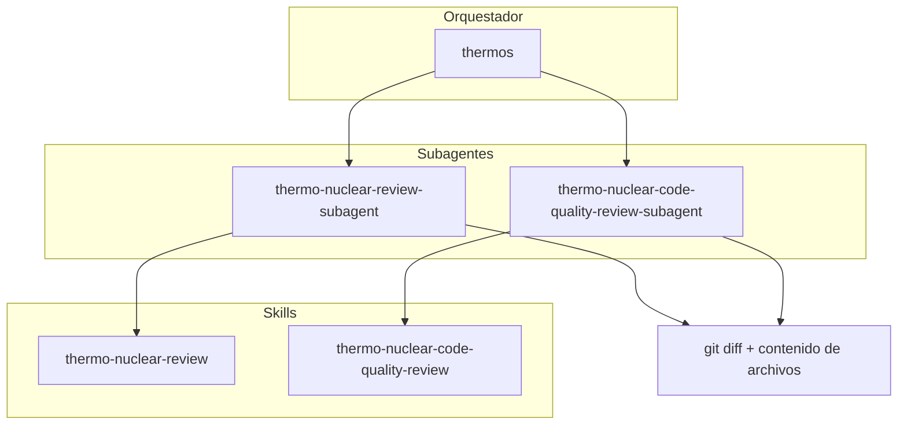

# Plugin Thermos

Revisión de ramas con pensamiento termonuclear: auditorías profundas de corrección y seguridad, rúbricas exigentes de calidad de código y orquestación con subagentes en paralelo.

Esta carpeta es un espejo de [cursor/plugins/thermos](https://github.com/cursor/plugins/tree/main/thermos) (MIT, ver LICENSE) adaptado a Claude Code, con un manifiesto `.claude-plugin/plugin.json` y `disable-model-invocation` quitado de las tres skills para que Claude pueda activarlas por sí mismo.

## Instalación en Claude Code

En el prompt de una sesión de terminal:

```text
/plugin install thermos --marketplace Jmezas/claude-mods
```

Desde una shell: `claude plugin install thermos --marketplace Jmezas/claude-mods`.

## Instalación en Cursor (upstream)

```bash
/add-plugin thermos
```

## Arquitectura



## Skills

| Skill | Descripción |
|:------|:------------|
| `thermo-nuclear-review` | Auditoría profunda de la rama (errores, roturas, seguridad, experiencia de desarrollo, fugas de feature flags). |
| `thermo-nuclear-code-quality-review` | Auditoría estricta de mantenibilidad (code-judo, regla de 1k líneas, código espagueti, fronteras). |
| `thermos` | Lanza ambos subagentes de revisión en paralelo y sintetiza los hallazgos. |

## Agentes

| Agente | Descripción |
|:------|:------------|
| `thermo-nuclear-review-subagent` | Subagente de tarea para la rúbrica de revisión profunda (limitada al diff). |
| `thermo-nuclear-code-quality-review-subagent` | Subagente de tarea para la rúbrica de calidad de código (limitada al diff). |

## Uso típico

**Doble revisión (thermos):**

1. Obtén `git diff main...HEAD` y el contenido completo de los archivos cambiados.
2. Invoca ambos subagentes en un solo mensaje con `run_in_background: true`.
3. Sintetiza los hallazgos priorizados y sin duplicados.

**Skill individual:** invoca `thermo-nuclear-review` o `thermo-nuclear-code-quality-review` en el agente principal, o el subagente correspondiente tras reunir el contexto del diff.

## Migración desde cursor-team-kit

`cursor-team-kit` incluía antes solo `thermo-nuclear-code-quality-review`. Esa skill y su agente viven ahora en **Thermos**, junto a la revisión profunda y `thermos`. Elimina las entradas thermo antiguas de team-kit al instalar este plugin para evitar duplicados.

## Licencia

MIT
